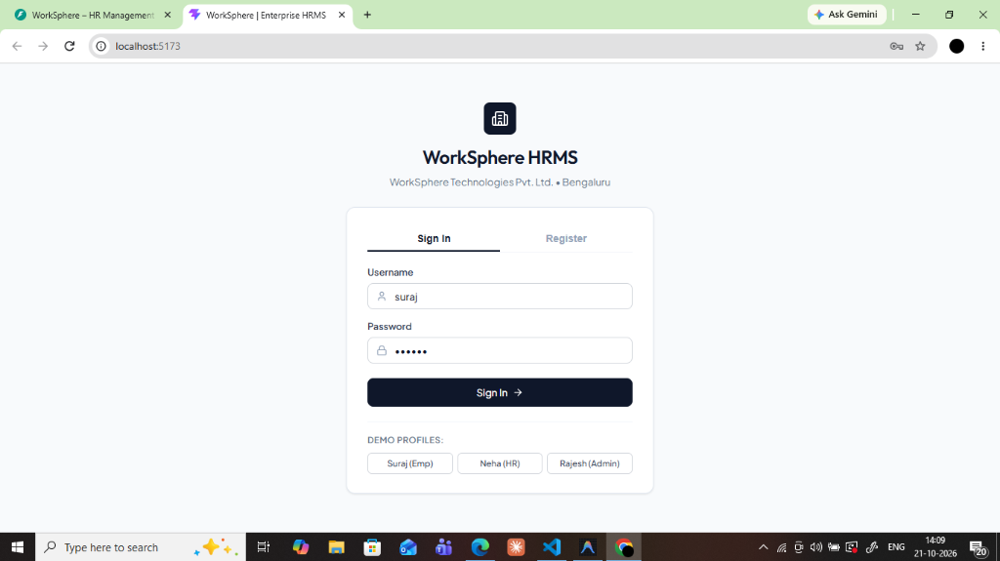
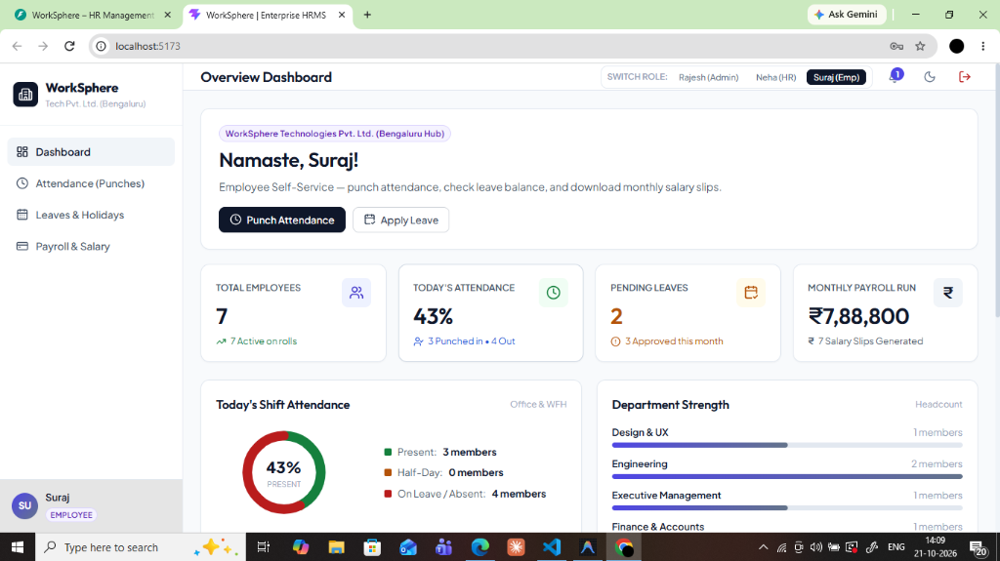

# WorkSphere – HR Management System (HRMS)

**WorkSphere** is a modern, enterprise-grade HR Management System built using **FastAPI** (Python 3.13) and **React** (Vite). It provides comprehensive workforce management across employee onboarding, attendance tracking, leave request lifecycles, monthly payroll processing, real-time analytics, and notification center with strict Role-Based Access Control (RBAC).

---

## 🏛️ System Architecture

```
WorkSphere HRMS
├── backend/
│   ├── venv/                   # Python Virtual Environment
│   ├── database.py             # SQLite / SQLAlchemy Engine & Session
│   ├── models.py               # ORM Database Models (Users, Employees, Attendance, Leaves, Payroll, Notifications)
│   ├── schemas.py              # Pydantic Schemas for Validation & Serialization
│   ├── auth.py                 # JWT Authentication & RBAC Guard Dependencies
│   ├── seed_data.py            # Pre-configured Enterprise Mock Data Seed
│   ├── test_api.py             # Complete End-to-End Backend Test Suite
│   ├── main.py                 # FastAPI Application with CORS & Routers
│   └── routers/
│       ├── auth.py             # /api/auth (Login, Register, Me)
│       ├── employees.py        # /api/employees (CRUD, Search, Filter)
│       ├── attendance.py       # /api/attendance (Check-In, Check-Out, History)
│       ├── leaves.py           # /api/leaves (Apply, Approve, Reject)
│       ├── payroll.py          # /api/payroll (Generate, History, Payslip)
│       ├── dashboard.py        # /api/dashboard (KPI Metrics & Charts)
│       └── notifications.py    # /api/notifications (Read, Mark All Read)
│
└── frontend/
    ├── src/
    │   ├── components/
    │   │   ├── NotificationsModal.jsx  # Real-time Notifications Drawer
    │   │   └── PayslipModal.jsx        # Corporate Salary Payslip Receipt
    │   ├── views/
    │   │   ├── LoginView.jsx           # JWT Auth, Register, 1-Click Demo Accounts
    │   │   ├── DashboardView.jsx       # KPI Metrics, Attendance Donut, Dept Breakdown
    │   │   ├── EmployeesView.jsx       # Employee Directory, Profile Modal, Add/Edit
    │   │   ├── AttendanceView.jsx      # Live Clock, Check-in/out, Shift History
    │   │   ├── LeavesView.jsx          # Leave Application & HR Approval Actions
    │   │   └── PayrollView.jsx         # Salary Records, Generator, PDF-Ready Payslip
    │   ├── services/
    │   │   └── api.js                  # Centralized Fetch Client with Bearer Token
    │   ├── App.jsx                     # Shell Layout, Navigation, Role Switcher
    │   ├── App.css                     # Custom Layouts & Components
    │   └── index.css                   # Enterprise CSS Design System (Dark/Light Modes)
    └── vite.config.js                  # Vite Config with Backend Proxy
```

---

## 📸 Application Screenshots

| Sign In Screen | Employee Dashboard |
|:---:|:---:|
|  |  |

| Attendance & Punch Management | Leaves & Approvals |
|:---:|:---:|
| .png) | .png) |

| Payroll & Payslip Generation | Corporate Payslip Preview |
|:---:|:---:|
| .png) | .png) |

---

## 🚀 Features by Module

### Module 1: User Authentication & Roles
- **JWT Authentication** with password hashing using `bcrypt`.
- **RBAC (Role-Based Access Control)** supporting 3 authority tiers: `ADMIN`, `HR`, and `EMPLOYEE`.
- **Role Isolation**: Sensitive views like Employee Directory and Salary configurations are restricted exclusively to HR and Admin roles.

### Module 2: Employee Management
- Search employees in real-time by name, designation, or department.
- Filter by department (`Engineering`, `Design & UX`, `Human Resources`, `Marketing`, `Finance`, `Executive`) or employment status (`ACTIVE` / `INACTIVE`).
- Modal forms to onboard new employees with automated user account creation.
- Detailed employee profile viewer with contact and compensation records.

### Module 3: Attendance Management
- Live workstation clock with real-time seconds ticker and shift status.
- Self-service **Check-In** and **Check-Out** buttons with automated duty hours calculation.
- Status classification: `PRESENT` (>= 7.5 hrs), `HALF_DAY` (>= 4 hrs), or `ABSENT`.
- Attendance history table with date filtering.
- HR/Admin manual shift logging & override modal.

### Module 4: Leave Management System
- Self-service leave application form (`SICK`, `CASUAL`, `PAID` time off).
- Metric counters tracking pending, approved, and rejected requests.
- One-click **Approve** and **Reject** workflows for HR & Admin with instant notification triggers and confetti animations.

### Module 5: Payroll Management
- Monthly compensation runs with customizable Basic Salary, Performance Bonus, and Benefit/Tax Deductions.
- Automatic Net Salary computation.
- Detailed corporate **Salary Payslip** modal ready for instant printing or PDF export.

### Module 6: Dashboard & Analytics
- Executive KPI overview: Total Employees, Active on Duty, Today's Attendance Rate, Pending Leaves, Monthly Payroll Expense.
- Visual SVG Donut chart displaying today's attendance ratio.
- Headcount distribution progress bars by department.
- Live feed of recent attendance check-ins and pending leave applications.

### Module 7: Notifications Center
- Real-time unread notification badge counter in topbar.
- Automated system notifications triggered by:
  - Leave approval or rejection
  - New payslip disbursement
  - Profile onboarding
- Mark as read and mark all as read support.

---

## 🔑 Demo Login Credentials (India Hub)

| Role | Username | Password | Full Name & Title |
|---|---|---|---|
| **System Admin** | `admin` | `admin123` | Rajesh Sharma (Director of Engineering & Systems Admin) |
| **HR Operations** | `neha_hr` | `hr123` | Neha Kulkarni (Manager - People Operations & HR) |
| **Developer** | `suraj` | `emp123` | Suraj (Senior Full-Stack Engineer) |

---

## 💻 How to Run Locally

### 1. Backend (FastAPI)
```bash
# From workspace root
cd backend
# Activate Python Virtual Environment
venv\Scripts\activate   # Windows
# Run server with auto-reload
python -m uvicorn main:app --host 127.0.0.1 --port 8000 --reload
```
API Documentation (Interactive Swagger UI): `http://127.0.0.1:8000/docs`

### 2. Frontend (React + Vite)
```bash
# In a new terminal window, from workspace root
cd frontend
# Start Vite development server
npm run dev
```
WorkSphere HRMS App: `http://localhost:5173`

### 3. Run Backend Test Suite
```bash
backend\venv\Scripts\python backend\test_api.py
```
