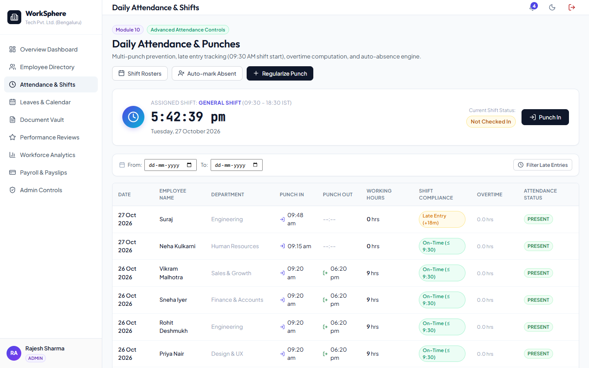
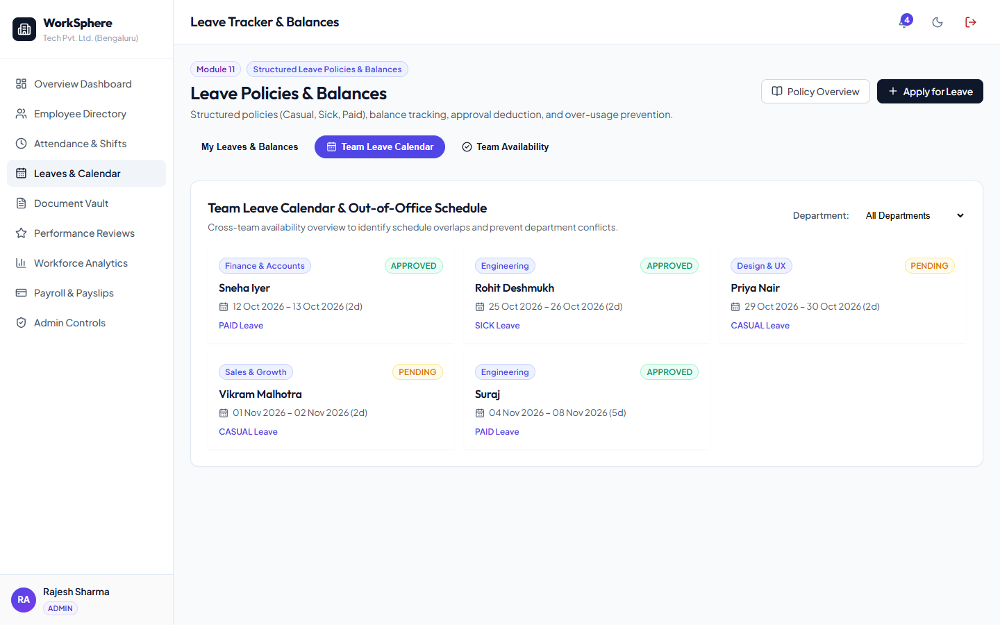
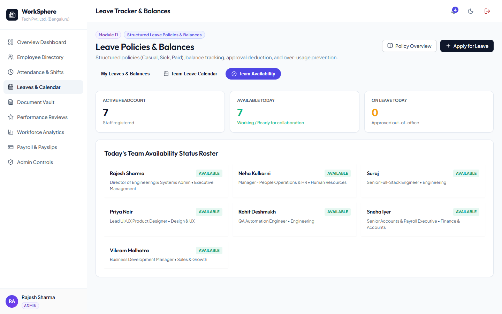
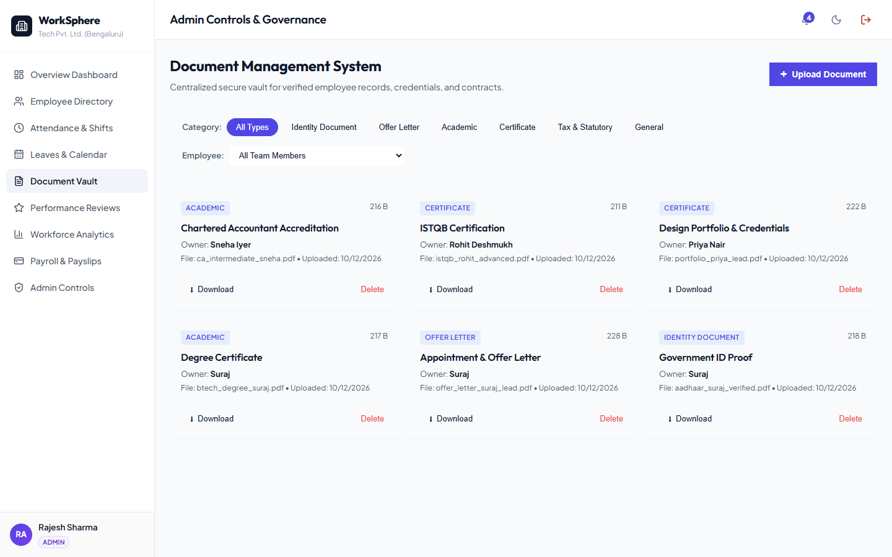
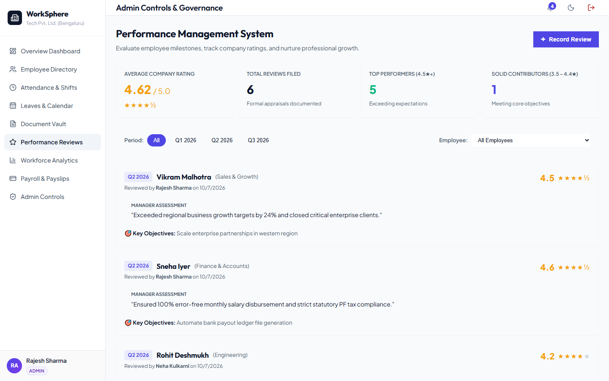
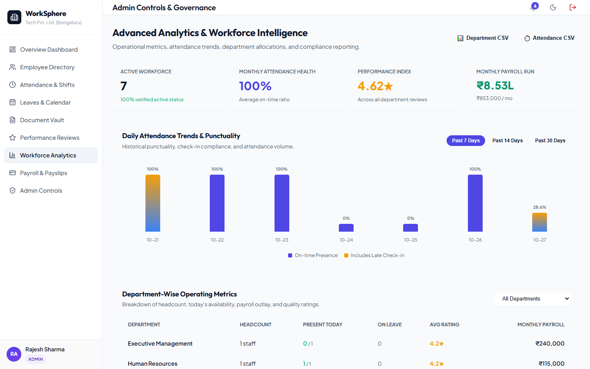
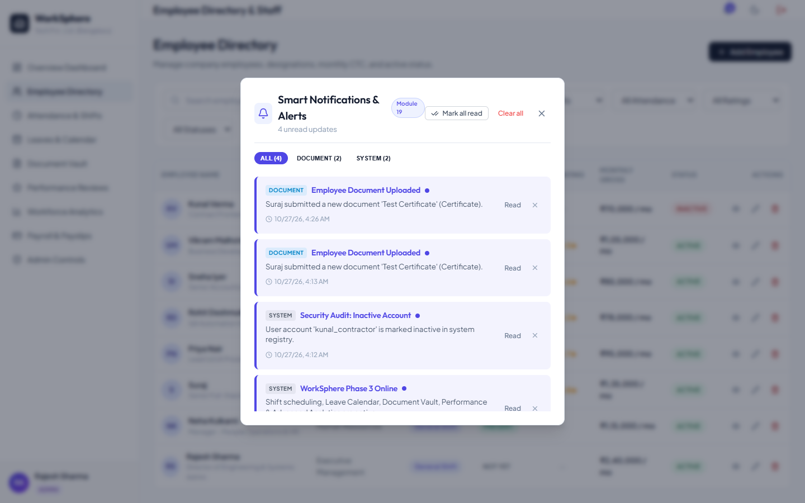
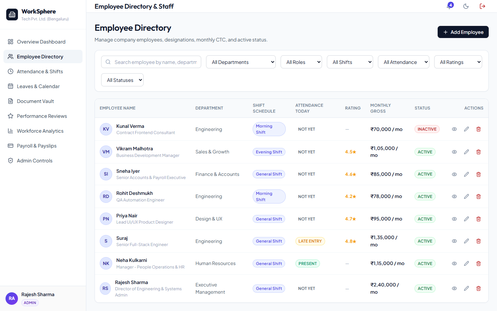

# WorkSphere – HR Management System (HRMS)

**WorkSphere** is a modern, enterprise-grade HR Management System built using **FastAPI** (Python 3.13) and **React** (Vite).
Following the completion of Phase 1 and Phase 2, **Phase 3** enhances WorkSphere into an intelligent, automated HR platform with **Automated Attendance & Shift Management**, **Team Leave Calendar & Out-of-Office Conflicts**, a **Secure Document Management Vault**, a **Performance Review & Ratings System**, **Advanced Workforce Analytics & CSV Reports**, **Smart Notifications & Alert Categorization**, and **Advanced Multi-Faceted Employee Search**.

---

## 🏛️ System Architecture

```
WorkSphere HRMS (Phase 3 Enterprise Upgrade)
├── backend/
│   ├── venv/                   # Python Virtual Environment
│   ├── database.py             # SQLite / SQLAlchemy Engine & Session
│   ├── models.py               # ORM Models (Users, Employees, Shifts, EmployeeShifts, Attendance, Leaves, LeavePolicy, LeaveBalance, Documents, Performance, Payroll, Notifications)
│   ├── schemas.py              # Pydantic Schemas for Validation & Serialization
│   ├── auth.py                 # JWT Authentication, is_active checks & RBAC Guards
│   ├── seed_data.py            # Phase 3 Database Seeding (Shifts, Docs, Performance, Balances, Payroll)
│   ├── test_api.py             # Comprehensive Test Suite (100% Passing)
│   ├── main.py                 # FastAPI Application with CORS & Phase 3 Routers
│   ├── uploads/                # Encrypted Local Vault for Verified Employee Documents
│   └── routers/
│       ├── auth.py             # /api/auth (Login, Register, Me)
│       ├── employees.py        # /api/employees (CRUD, Search, Multi-Filters, Shift/Rating/Attendance Badges)
│       ├── attendance.py       # /api/attendance (Shift-aware Check-In, Late Tracking, Overtime, Auto-Mark)
│       ├── leaves.py           # /api/leaves (Apply, Balances, Policies, Calendar, Availability, Conflict Engine)
│       ├── shifts.py           # /api/shifts (CRUD Shifts, Shift Assignments, My-Shift)
│       ├── documents.py        # /api/documents (Upload, Secure Download, Category Filters, RBAC)
│       ├── performance.py      # /api/performance (Reviews, Star Ratings, Goals, HR Stats)
│       ├── analytics.py        # /api/analytics (Workforce Overview, Daily Attendance Trends, CSV Exports)
│       ├── payroll.py          # /api/payroll (Generate Breakdown, Summary, Payslip)
│       ├── dashboard.py        # /api/dashboard (Executive KPIs & ESS Personal Telemetry)
│       ├── notifications.py    # /api/notifications (Categorized Alerts, Mark Read, Clear/Delete)
│       └── admin.py            # /api/admin (User Management, Role Assignments, Status Toggles, Security Stats)
│
└── frontend/
    ├── src/
    │   ├── components/
    │   │   ├── NotificationsModal.jsx  # Smart Alerts Drawer with 8 Category Filters & Clear All
    │   │   └── PayslipModal.jsx        # Indian Form 16 Salary Payslip Receipt (HRA, Spl, PF, Tax)
    │   ├── views/
    │   │   ├── LoginView.jsx           # JWT Auth, Register, 1-Click Role Logins (Admin, HR, Emp, Deactive)
    │   │   ├── DashboardView.jsx       # Employee Self-Service (ESS) Portal & Executive KPI Dashboard
    │   │   ├── EmployeesView.jsx       # Advanced Search & Multi-Filters (Shift, Rating, Attendance, Role)
    │   │   ├── AttendanceView.jsx      # Shift Schedule Display, Shift Roster Modal, Late Entry Alerts
    │   │   ├── LeavesView.jsx          # Leave Balances, Team Leave Calendar, Team Availability Dashboard & Conflict Detection
    │   │   ├── DocumentsView.jsx       # Module 16 Secure Document Vault & File Upload Modal
    │   │   ├── PerformanceView.jsx     # Module 17 Performance Reviews, Star Ratings, Stats & Goal Tracking
    │   │   ├── AnalyticsView.jsx       # Module 18 Visual Trend Charts, Department Reports & CSV Export
    │   │   ├── PayrollView.jsx         # Salary Breakdown Generator, Monthly Summary KPI Bar, Payslips
    │   │   └── AdminControlsView.jsx   # Module 13 User Governance, Role Assignment, Activation Switches
    │   ├── services/
    │   │   └── api.js                  # Centralized Fetch Client with Bearer Token & Phase 3 APIs
    │   ├── App.jsx                     # Shell Layout, RBAC Route Protection, Dynamic Role Navigation
    │   ├── App.css                     # Custom Layouts & Components
    │   └── index.css                   # Enterprise CSS Design System (Badges, Switch Toggles, Progress Bars)
    └── vite.config.js                  # Vite Config with Backend Proxy
```

---

## 📸 Phase 3 Feature Showcase (Screenshots)

| Feature & Module | Screenshot Preview |
|---|---|
| **Module 14: Shift Schedules & Timing** |  |
| **Module 14: Shift Rosters & Assignment** |  |
| **Module 15: Team Leave Calendar** |  |
| **Module 15: Team Availability Dashboard** |  |
| **Module 16: Document Vault & Uploads** |  |
| **Module 17: Performance Reviews & Ratings** |  |
| **Module 18: Workforce Analytics & Trends** |  |
| **Module 19: Smart Notifications & Alerts** |  |
| **Module 20: Advanced Employee Search & Filters** |  |

---

## 🚀 Complete 20-Module Feature Breakdown

### Phase 1: Core Foundation & HR Workflows (Modules 1–7)
- **Module 1**: Modern responsive SPA foundation with minimalist design system.
- **Module 2**: Full CRUD Employee Management with Indian rupee salary formatting.
- **Module 3**: Daily Attendance Punch system with check-in/out logging.
- **Module 4**: Leave Application and Approval workflow.
- **Module 5**: Automated Monthly Payroll generator with net salary calculation.
- **Module 6**: Real-time Executive KPI dashboard.
- **Module 7**: System notifications drawer.

---

### Phase 2: Role-Based Access Control & Advanced HR Workflows (Modules 8–13)
- **Module 8: Role-Based Access Control (RBAC)**:
  - User roles (`EMPLOYEE`, `HR`, `ADMIN`) embedded in JWT tokens.
  - Strict endpoint authorization via `require_roles([allowed_roles])`.
  - Immediate login rejection (`403 Forbidden`) for deactivated accounts.
- **Module 9: Employee Self-Service (ESS) Portal**:
  - Personalized employee view for profile details, punch status, leave balances, and payslips.
- **Module 10: Advanced Attendance Controls**:
  - Duplicate check-in prevention, late check-in detection, overtime tracking, and auto-absence engine.
- **Module 11: Leave Policies & Balances**:
  - Separate policy allowances for Casual (12d), Sick (10d), and Paid (18d) leave.
  - Live over-usage validation preventing applications exceeding remaining balance.
- **Module 12: Granular Payroll Breakdown**:
  - Basic (50%), HRA (30%), Special Allowance (20%), PF (12%), Professional Tax, and Income Tax deductions.
  - Detailed corporate payslip receipt with print support.
- **Module 13: Admin Controls & User Governance**:
  - Admin panel for creating accounts, switching roles, resetting passwords, and toggling user activation.

---

### Phase 3: Automation, Insights & Smart HR Features (Modules 14–20)

#### Module 14: Automated Attendance & Shift Management
- **Shift Definitions**: Pre-configured shifts including Morning Shift (08:00 – 16:30), General Shift (09:30 – 18:30), Evening Shift (14:00 – 22:30), and Night Shift (22:00 – 06:30).
- **Shift Assignments**: HR and Admin can assign team members to specific shift rosters via `/api/shifts/assign` and the Shift Rosters UI modal.
- **Shift-Aware Late Detection**: Attendance punch evaluations dynamically assess punctuality against the employee's active shift start time (with 15-minute grace period).
- **Employee Shift Schedule View**: The digital clock banner displays the employee's assigned shift name and working hours in real time.

#### Module 15: Leave Calendar & Team View
- **Team Leave Calendar**: Visual schedule grid mapping upcoming employee out-of-office dates, filterable by department.
- **Team Availability Dashboard**: Real-time operational roster displaying who is Available vs On Leave today across all corporate departments.
- **Leave Conflict Engine**: Automated overlap detection (`/api/leaves/conflicts`) alerts employees if colleagues in their department already have scheduled leaves during the requested dates.

#### Module 16: Document Management System
- **Secure File Storage**: Local encrypted vault (`backend/uploads/`) for verified employee documents.
- **Document Categories**: Identity Documents (Aadhaar, Passport), Offer Letters, Academic Degrees, Professional Certifications, and Tax Forms.
- **Role-Isolated Access**: Employees securely view and download only their verified personal documents; HR and Admin can audit and manage company-wide files.
- **Direct File Downloads**: Secure streaming endpoint (`/api/documents/{id}/download`) enforcing JWT ownership checks.

#### Module 17: Performance Management System
- **Appraisal Records**: Structured performance evaluations with review periods (e.g. Q1, Q2, Q3, Annual), 1.0 to 5.0 star ratings, qualitative manager feedback, and forward-looking milestones.
- **Company Rating Analytics**: High-level statistics on average company rating, total reviews filed, top performer distribution (4.5★+), and solid contributor ratios.
- **Employee Review History**: Employees can view their historical manager appraisals and career growth milestones.

#### Module 18: Advanced Analytics & Reports
- **Attendance Trend Patterns**: Interactive visual bar charts illustrating daily punctuality, on-time presence rates, and late check-in volumes over 7, 14, or 30 days.
- **Department Operational Metrics**: Headcount allocations, daily present counts, active leaves, average performance index, and monthly payroll disbursement per department.
- **CSV Data Exports**: One-click direct downloads for Department Analytics CSV, Attendance Audit Log CSV, and Leave History CSV.

#### Module 19: Smart Notifications & Alerts
- **Categorized Alert Engine**: Notifications are systematically classified into `ATTENDANCE`, `LEAVE`, `PAYROLL`, `SHIFT`, `PERFORMANCE`, `DOCUMENT`, and `SYSTEM`.
- **Automated Event Triggers**: Instant alerts generated on late entry, shift reassignment, payslip credit, appraisal publishing, and leave status updates.
- **Filterable Notification Drawer**: Filter alerts by category pills, mark all as read, dismiss individual alerts, or clear all.

#### Module 20: Employee Search & Filters (Advanced)
- **Multi-Faceted Search**: Instant search by Name, Department, Designation, or Email.
- **Facet Dropdowns**:
  - Filter by User Role (`ADMIN`, `HR`, `EMPLOYEE`)
  - Filter by Assigned Shift (`General Shift`, `Morning Shift`, `Evening Shift`, `Night Shift`)
  - Filter by Today's Attendance (`PRESENT`, `LATE ENTRY`, `ABSENT`, `NOT YET`)
  - Filter by Performance Rating (`4.5★ & Above`, `4.0★ & Above`, `3.5★ & Above`)
  - Filter by Account Status (`ACTIVE`, `INACTIVE`)
- **Rich Table Indicators**: Table rows showcase assigned shift badges, live attendance pill tags, and star ratings alongside compensation and status.

---

## 🔑 Default Seeded Accounts & Credentials

| Role | Username | Password | Full Name | Department | Assigned Shift |
|---|---|---|---|---|---|
| **Admin** | `admin` | `admin123` | Rajesh Sharma | Executive Management | General Shift (09:30 - 18:30) |
| **HR Manager** | `neha_hr` | `hr123` | Neha Kulkarni | Human Resources | General Shift (09:30 - 18:30) |
| **Employee** | `suraj` | `emp123` | Suraj | Engineering | General Shift (09:30 - 18:30) |
| **Employee** | `priya_ui` | `emp123` | Priya Nair | Design & UX | General Shift (09:30 - 18:30) |
| **Employee** | `rohit_qa` | `emp123` | Rohit Deshmukh | Engineering | Morning Shift (08:00 - 16:30) |
| **Employee** | `sneha_fin` | `emp123` | Sneha Iyer | Finance & Accounts | General Shift (09:30 - 18:30) |
| **Employee** | `vikram_sales` | `emp123` | Vikram Malhotra | Sales & Growth | Evening Shift (14:00 - 22:30) |
| **Deactivated** | `kunal_contractor` | `emp123` | Kunal Verma | Engineering | Inactive (403 Blocked) |

---

## 🛠️ Verification & Test Execution

Run the end-to-end automated test suite to verify all Phase 1, Phase 2, and Phase 3 modules:

```powershell
cd backend
.\venv\Scripts\python test_api.py
```

Expected output:
```
=== Testing WorkSphere Phase 3 (Automation, Insights & Smart HR Features) ===
 [OK] Root health check & Phase 3 API version 3.0.0 verified
 [OK] Admin, HR, and Employee JWT authentication tokens verified
 [OK] Shift Management: Retrieved 4 shifts (General: 09:30 - 18:30)
 [OK] Employee Shift View: Active shift 'General Shift' confirmed for Suraj
 [OK] Shift Assignments: HR retrieved 8 active assignments
 [OK] Team Leave Calendar: 5 calendar events loaded
 [OK] Leave Conflict Engine: Evaluated schedule (has_conflict=False)
 [OK] Team Availability Dashboard: 7 active available team members
 [OK] Document Vault: Employee retrieved 3 verified personal documents
 [OK] Secure Document Download: Downloaded document 3 successfully
 [OK] Document Upload: Successfully uploaded test document (ID=7)
 [OK] Document Deletion: Cleaned up temporary test document
 [OK] Performance Reviews: Employee retrieved 2 reviews (Latest: 4.9* in Q2 2026)
 [OK] Performance Analytics: Average rating 4.62 across 6 reviews
 [OK] Analytics Overview: 7 daily trend points, 6 department reports
 [OK] Reports Export: Successfully exported department analytics CSV
 [OK] Smart Notifications: Category filter 'SYSTEM' returned 2 items
 [OK] Smart Notifications: Category filter 'SHIFT' returned 1 items
 [OK] Advanced Search: Found employee by name 'Suraj'
 [OK] Shift Filter: Filtered 5 employees in General Shift
 [OK] Performance Filter: Found 4 employees with >= 4.5 avg rating

 All 20 WorkSphere Modules (Phase 1, 2, and 3) verified successfully with 100% test pass!
```

---

## 💻 Running Locally

### Backend (FastAPI)
```powershell
cd backend
.\venv\Scripts\uvicorn main:app --host 127.0.0.1 --port 8000 --reload
```
API Documentation: [http://127.0.0.1:8000/docs](http://127.0.0.1:8000/docs)

### Frontend (React + Vite)
```powershell
cd frontend
npm run dev
```
Client URL: [http://localhost:5173](http://localhost:5173)
